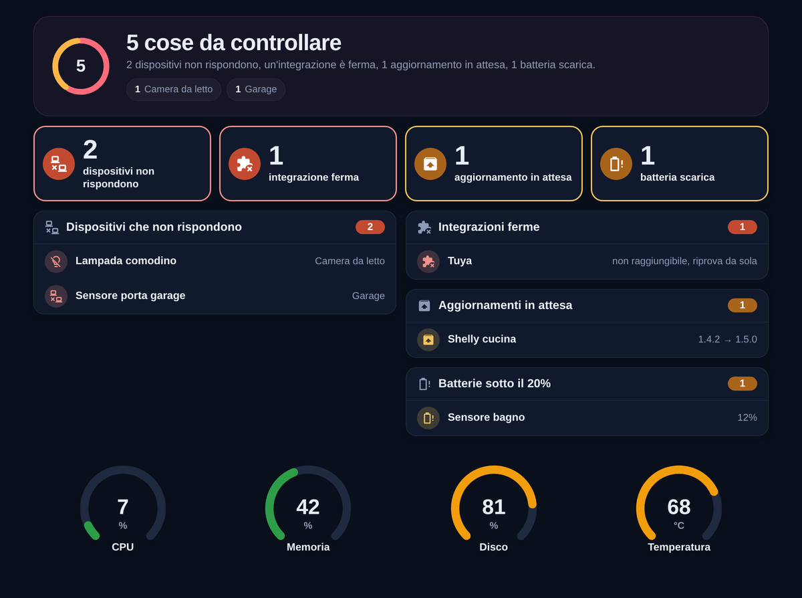
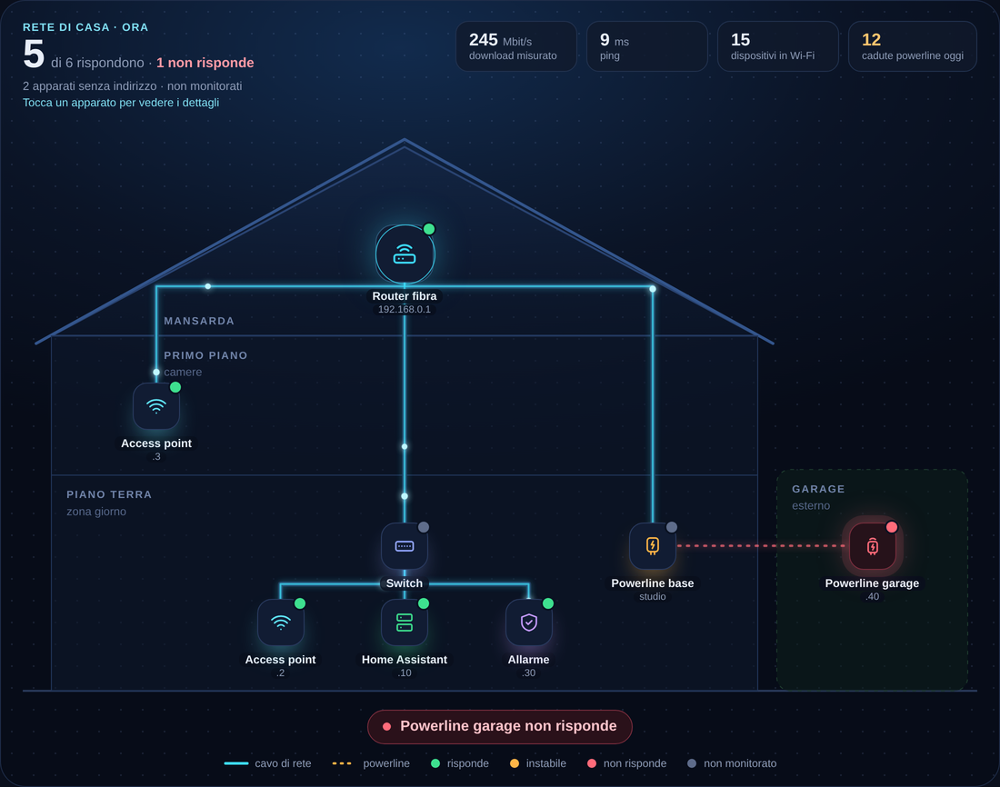

# Homeray

**La radiografia della tua casa in Home Assistant.** Homeray ti mostra a colpo d'occhio cosa non funziona nella tua casa intelligente: dispositivi che non rispondono, integrazioni ferme, aggiornamenti in attesa e batterie scariche. Non va configurato.

[](https://paypal.me/AndreaGuarducci1992)

🇬🇧 [Read in English](README.md)



## Le card

| Card | Cosa fa |
| --- | --- |
| `homeray-issues-card` | Trova da sola i dispositivi che non rispondono, le integrazioni ferme, gli aggiornamenti in attesa e le batterie scariche, divisi per stanza. Toccando una riga si apre il dettaglio. |
| `homeray-gauge-card` | Indicatore ad anello con soglie di colore, per CPU, memoria, disco, temperatura o qualsiasi sensore numerico. |

Le card usano la lingua di Home Assistant: italiano se Home Assistant è in italiano, altrimenti inglese.

## Installazione

### Con HACS (consigliata)

1. HACS → tre puntini in alto a destra → **Repository personalizzati**.
2. Repository: `https://github.com/DarkBeccio/homeray-cards`, tipo: **Dashboard**.
3. Cerca **Homeray**, scaricalo e ricarica la pagina.

### A mano

1. Scarica [`homeray-cards.js`](https://github.com/DarkBeccio/homeray-cards/raw/main/homeray-cards.js) e copialo in `/config/www/`.
2. Impostazioni → Dashboard → tre puntini → **Risorse** → **Aggiungi risorsa**: URL `/local/homeray-cards.js?v=1.0.2`, tipo **Modulo JavaScript**.
3. Ricarica la pagina (Ctrl+Maiusc+R). Nella console del browser compare `HOMERAY 1.0.2`.

## Quadro dei problemi

```yaml
type: custom:homeray-issues-card
summary: true
dark: true
```

| Opzione | Predefinito | Cosa fa |
| --- | --- | --- |
| `summary` | `false` | Mostra il riepilogo in cima: totale e stanze con più problemi (va bene anche `riepilogo`) |
| `dark` | `false` | Colori pieni per il tema scuro, invece dell'effetto vetro |
| `battery` | `20` | Soglia in % sotto cui una batteria è "scarica" (da 0 a 100) |
| `rows` | `7` | Righe mostrate per riquadro prima di "Mostra tutti" (1 o più) |
| `exclude_label` | `fuori_monitoraggio` | ID dell'etichetta dei dispositivi da ignorare del tutto: disponibilità, aggiornamenti e batterie |

Un dispositivo risulta "non risponde" quando almeno una sua entità è non disponibile e nessun'altra ha uno stato reale (sono tutte non disponibili o sconosciute). È una stima basata sulle entità, non una verifica diretta della connessione. Tra le batterie scariche ci sono i sensori di batteria sotto soglia e i sensori binari di batteria che segnalano "scarica"; un dispositivo già elencato con la percentuale non viene contato due volte. Se le integrazioni non si possono leggere, la card lo dice invece di mostrare "Tutto a posto". Ai dispositivi che si spengono di proposito (una lavatrice, una TV staccata) dai l'etichetta "Fuori monitoraggio".

## Indicatore ad anello

```yaml
type: custom:homeray-gauge-card
entity: sensor.system_monitor_processor_temperature
name: Temperatura
min: 20
max: 85
warn: 65
bad: 75
decimals: 0
grid_options: {columns: 3, rows: 3}
```

| Opzione | Predefinito | Cosa fa |
| --- | --- | --- |
| `entity` | obbligatoria | Il sensore numerico da mostrare |
| `name` | nome dell'entità | Scritta sotto l'anello |
| `min` / `max` | `0` / `100` | Valori dell'anello vuoto e pieno (`max` deve essere maggiore di `min`) |
| `warn` / `bad` | nessuna | Soglie dell'arancione e del rosso |
| `invert` | `false` | Colori al contrario: rosso quando il valore è basso, per esempio giorni a una scadenza |
| `unit` | unità dell'entità | Testo sotto il numero |
| `decimals` | 1 sotto 10, poi 0 | Cifre decimali (da 0 a 6) |

Quattro anelli da 3 colonne stanno su una riga.

## Homeray Pro

Vuoi vedere tutta la rete di casa, piano per piano? **Homeray Pro** aggiunge la mappa della casa: l'edificio disegnato a spaccato, con router, switch e access point nella loro stanza, i cavi e le powerline, lo stato in tempo reale e la scheda di ogni apparato. Si disegna da sola a partire dall'elenco dei piani e dei collegamenti.



Homeray Pro è in italiano e in inglese e comprende anche un tema scuro, una dashboard di sistema pronta, la modalità demo con dati finti e la guida completa. → **[homeray.app](https://homeray.app)**

## Sostieni il progetto

Homeray è gratis. Se ti fa risparmiare tempo, puoi [offrirmi un caffè](https://paypal.me/AndreaGuarducci1992) ☕

## Licenza

MIT © 2026 DarkBeccio. Homeray è un progetto indipendente, non affiliato a Home Assistant né a Nabu Casa.
