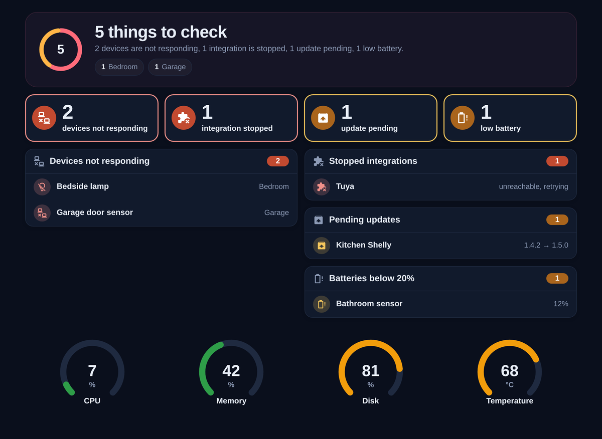
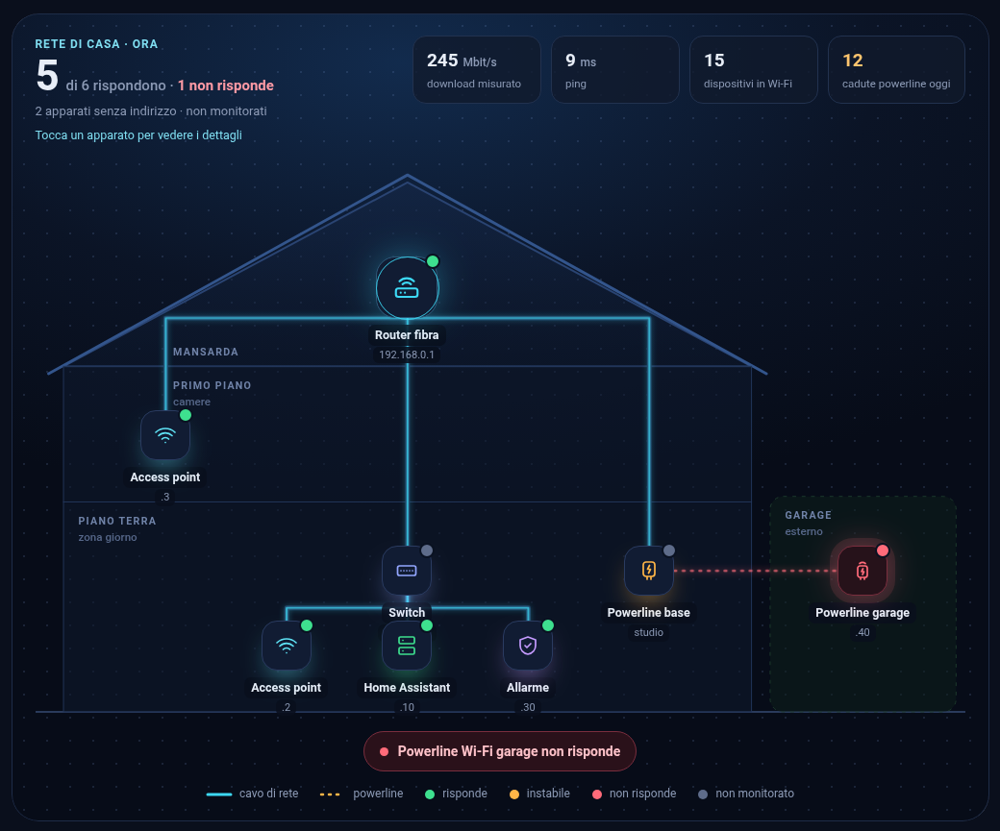

# Homeray

**An X-ray of your home in Home Assistant.** Homeray shows at a glance what is not working in your smart home: devices that stopped responding, integrations that failed, pending updates and low batteries. No configuration needed.

[](https://hacs.xyz)
[](https://github.com/DarkBeccio/homeray-cards/releases)
[](LICENSE)
[](https://paypal.me/AndreaGuarducci1992)

🇮🇹 [Leggi in italiano](README.it.md)



## Cards

| Card | What it does |
| --- | --- |
| `homeray-issues-card` | Finds on its own the devices that are not responding (and for how long), stopped integrations, pending updates and low batteries. TVs in standby are kept apart, and you can stop monitoring a device right from the card. Tap a row to open it. |
| `homeray-gauge-card` | A ring gauge with colour thresholds, for CPU, memory, disk, temperature or any numeric sensor. |

Both cards follow the language of Home Assistant: English, or Italian when Home Assistant is set to Italian.

## Installation

### HACS (recommended)

Homeray is in the default HACS store.

[](https://my.home-assistant.io/redirect/hacs_repository/?owner=DarkBeccio&repository=homeray-cards&category=plugin)

1. Open **HACS** and search for **Homeray**.
2. Open it, select **Download** and reload the page.

If Homeray does not show up in the search, add it as a custom repository: HACS → three dots (top right) → **Custom repositories** → repository `https://github.com/DarkBeccio/homeray-cards`, type **Dashboard**. Then search again.

### Manual

1. Download [`homeray-cards.js`](https://github.com/DarkBeccio/homeray-cards/raw/main/homeray-cards.js) and copy it to `/config/www/`.
2. Settings → Dashboards → three dots → **Resources** → **Add resource**: URL `/local/homeray-cards.js?v=1.1.0`, type **JavaScript module**.
3. Reload the page (Ctrl+Shift+R). The browser console shows `HOMERAY 1.1.0`.

## Issues card

```yaml
type: custom:homeray-issues-card
summary: true
dark: true
```

| Option | Default | Description |
| --- | --- | --- |
| `summary` | `false` | Shows the top summary: total count and the areas with the most issues |
| `dark` | `false` | Solid colours for dark themes instead of the glass look |
| `battery` | `20` | Battery level (%) below which a battery is "low" (0–100) |
| `rows` | `7` | Rows shown per panel before "Show all" (1 or more) |
| `exclude_label` | `fuori_monitoraggio` | Label ID of devices to ignore everywhere: availability, updates and batteries |
| `grace` | `5` | Minutes a device must stay unreachable before it is listed, so short drops do not raise an alarm (0 = list it at once) |
| `standby_domains` | `[media_player]` | Devices with an entity of these domains (TVs, speakers, streamers) go to the grey "Off or in standby" list instead of the red one. `[]` turns this off |

A device counts as "not responding" when at least one of its entities is unavailable and none of the others reports a real state (they are all unavailable or unknown). This is an estimate based on the entities, not a direct connectivity test. Each row shows how long the device has been unreachable, and the oldest outages come first; the time counts from the last change Home Assistant saw, so a restart starts it again. Low batteries include battery sensors below the threshold and binary battery sensors that report "low"; a device listed with its percentage is not counted twice. If the integrations cannot be read, the card says so instead of showing "All good".

**Stop monitoring a device.** Administrators see an eye button on each row: tap it, confirm, and the device gets the `exclude_label` label (the label is created if it does not exist yet). To monitor it again, open the folded "Ignored" list at the bottom. You can also add the label by hand in Settings → Devices. Non-administrators see no buttons.

## Gauge card

```yaml
type: custom:homeray-gauge-card
entity: sensor.system_monitor_processor_temperature
name: Temperature
min: 20
max: 85
warn: 65
bad: 75
decimals: 0
grid_options: {columns: 3, rows: 3}
```

| Option | Default | Description |
| --- | --- | --- |
| `entity` | required | Numeric sensor to show |
| `name` | entity name | Label under the ring |
| `min` / `max` | `0` / `100` | Values of the empty and full ring (`max` must be greater than `min`) |
| `warn` / `bad` | none | Orange and red thresholds |
| `invert` | `false` | Reverse colours: red when the value is low (e.g. days left) |
| `unit` | entity unit | Text under the number |
| `decimals` | 1 below 10, else 0 | Decimal digits (0–6) |

Four gauges of 3 columns fit on one row.

## Homeray Pro

Want to see your whole home network, floor by floor? **Homeray Pro** adds the home map: your house drawn as a cross-section, with every router, switch and access point in its room, real cables and powerline links, live status and a detail sheet for each device. It draws itself from a short list of floors and connections.



Homeray Pro speaks English and Italian, and also includes a reliability card (availability, drops and longest outage of each device over the last days), a Reload button for stopped integrations, a dark theme, a ready-made system dashboard, a demo mode with fake data and a full guide. → **[homeray.app](https://homeray.app)**

## Support the project

Homeray is free. If it saves you time, you can [buy me a coffee](https://paypal.me/AndreaGuarducci1992) ☕

## License

MIT © 2026 DarkBeccio. Homeray is an independent project and is not affiliated with Home Assistant or Nabu Casa.
