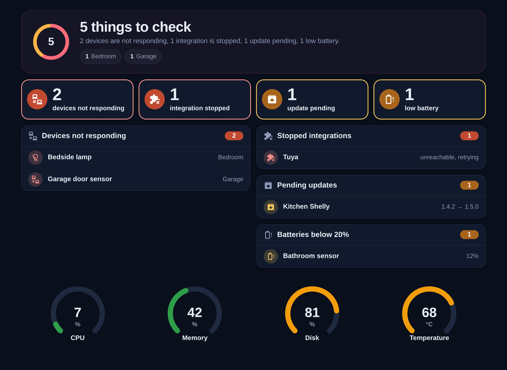
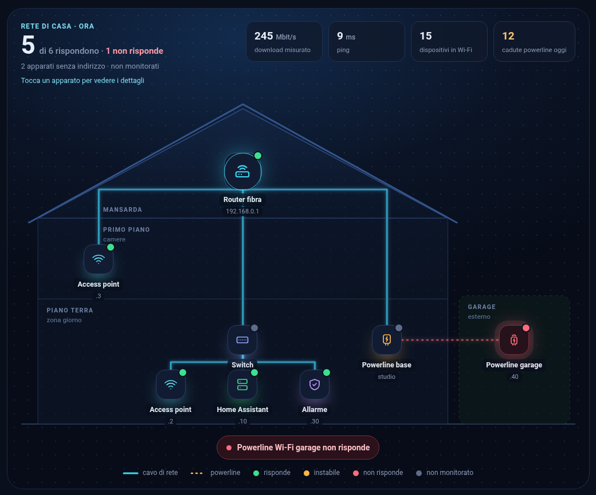

# Homeray

**An X-ray of your home in Home Assistant.** Homeray shows at a glance what is not working in your smart home: devices that stopped responding, integrations that failed, pending updates and low batteries. No configuration needed.

[](https://hacs.xyz/docs/faq/custom_repositories)
[](https://github.com/AndreaGuarducci/homeray-cards/releases)
[](LICENSE)

🇮🇹 [Leggi in italiano](README.it.md)



## Cards

| Card | What it does |
| --- | --- |
| `homeray-issues-card` | Finds on its own the devices that are not responding, stopped integrations, pending updates and low batteries, grouped by area. Tap a row to open it. |
| `homeray-gauge-card` | A ring gauge with colour thresholds, for CPU, memory, disk, temperature or any numeric sensor. |

Both cards follow the language of Home Assistant: English, or Italian when Home Assistant is set to Italian.

## Installation

### HACS (recommended)

1. HACS → three dots (top right) → **Custom repositories**.
2. Repository: `https://github.com/AndreaGuarducci/homeray-cards`, type: **Dashboard**.
3. Search for **Homeray**, download it and reload the page.

### Manual

1. Download `homeray-cards.js` from the [latest release](https://github.com/AndreaGuarducci/homeray-cards/releases) and copy it to `/config/www/`.
2. Settings → Dashboards → three dots → **Resources** → **Add resource**: URL `/local/homeray-cards.js?v=1.0.0`, type **JavaScript module**.
3. Reload the page (Ctrl+Shift+R). The browser console shows `HOMERAY 1.0.0`.

## Issues card

```yaml
type: custom:homeray-issues-card
summary: true
dark: true
```

| Option | Default | Description |
| --- | --- | --- |
| `summary` | `false` | Shows the top summary: total count and the areas with the most issues |
| `dark` | `false` | Solid colours for dark themes instead of the glass look |
| `battery` | `20` | Battery level (%) below which a battery is "low" |
| `rows` | `7` | Rows shown per panel before "Show all" |
| `exclude_label` | `fuori_monitoraggio` | Label ID of devices to ignore |

A device counts as "not responding" when **all** of its entities are unavailable. Devices that are switched off on purpose (a washing machine, a TV on a power strip) can be excluded with a label: create a label, add it to the device and set its ID in `exclude_label`.

## Gauge card

```yaml
type: custom:homeray-gauge-card
entity: sensor.system_monitor_processor_temperature
name: Temperature
min: 20
max: 85
warn: 65
bad: 75
decimals: 0
grid_options: {columns: 3, rows: 3}
```

| Option | Default | Description |
| --- | --- | --- |
| `entity` | required | Numeric sensor to show |
| `name` | entity name | Label under the ring |
| `min` / `max` | `0` / `100` | Values of the empty and full ring |
| `warn` / `bad` | none | Orange and red thresholds |
| `invert` | `false` | Reverse colours: red when the value is low (e.g. days left) |
| `unit` | entity unit | Text under the number |
| `decimals` | 1 below 10, else 0 | Decimal digits |

Four gauges of 3 columns fit on one row.

## Homeray Pro

Want to see your whole home network, floor by floor? **Homeray Pro** adds the home map: your house drawn as a cross-section, with every router, switch and access point in its room, real cables and powerline links, live status and a detail sheet for each device. It draws itself from a short list of floors and connections.



Homeray Pro also includes a dark theme, a ready-made system dashboard, a demo mode with fake data and a full guide. → **[homeray.app](https://homeray.app)**

## License

MIT © 2026 Andrea Guarducci. Homeray is an independent project and is not affiliated with Home Assistant or Nabu Casa.
